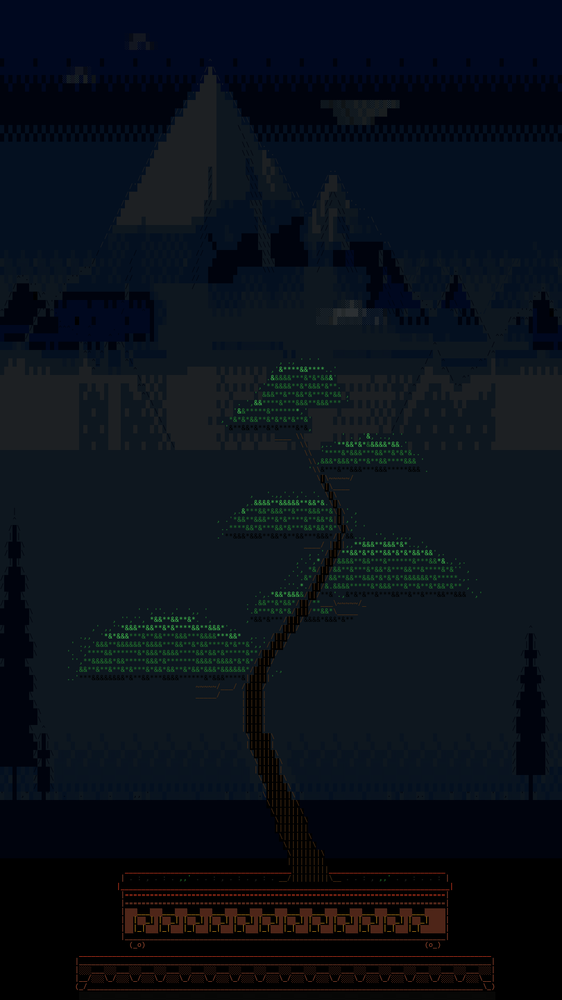
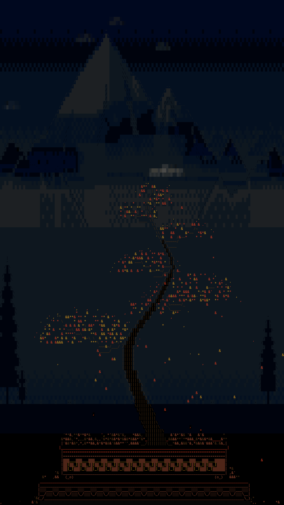
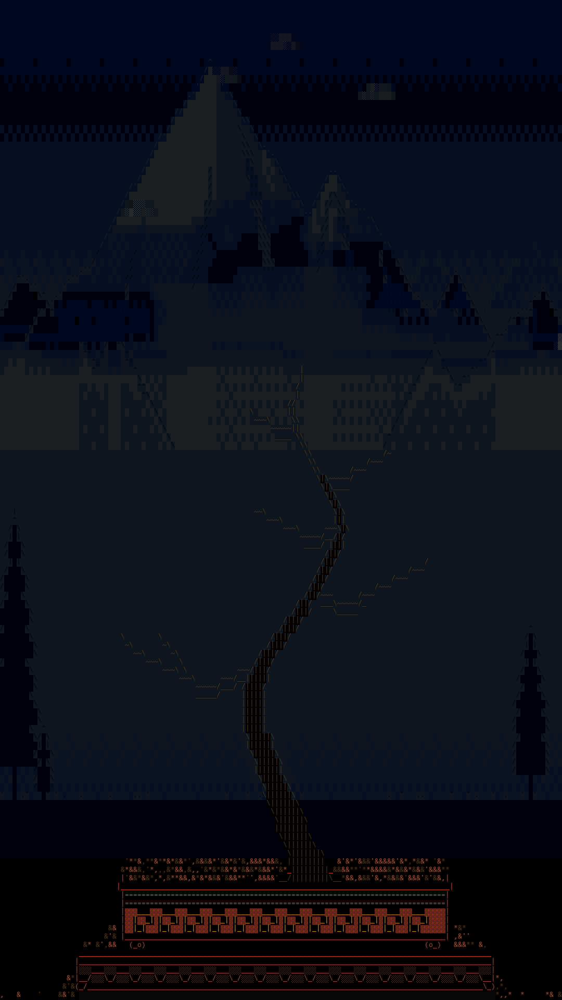
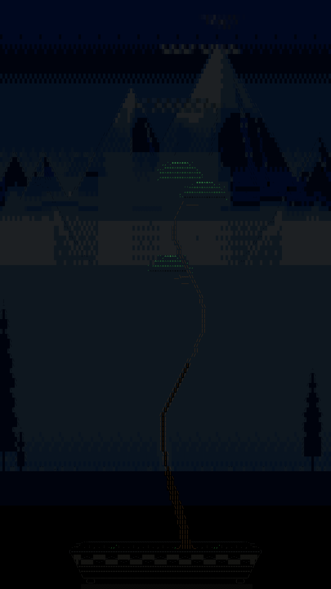
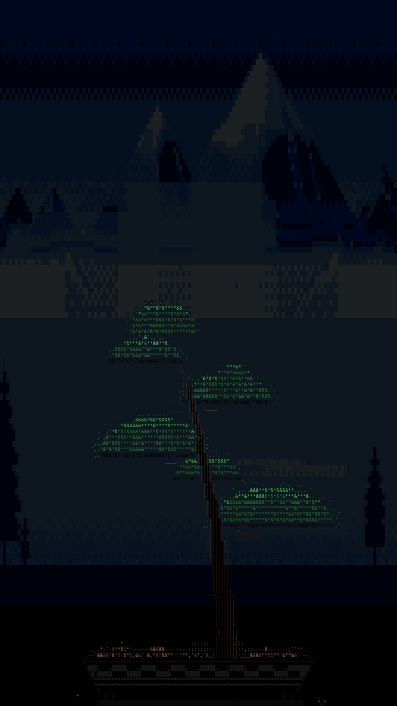
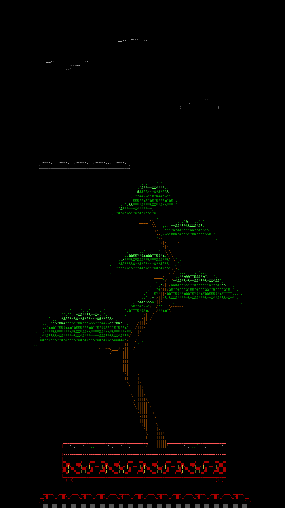
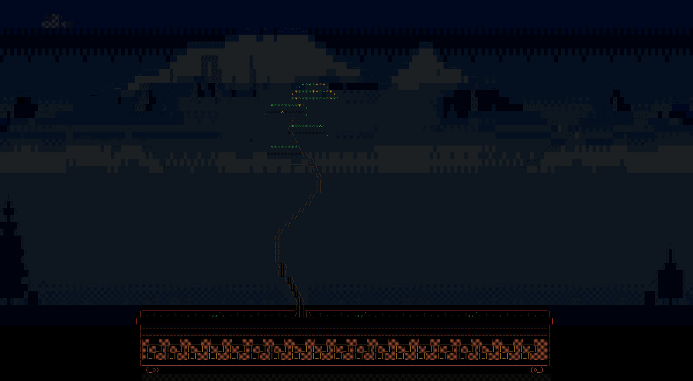

# xuuxij-bonsai

A bonsai screensaver for the text console. Each tree is planned in one of the classic
forms, drawn stroke by stroke like a pen, holds, turns colour, drops its leaves in the
breeze, crumbles into its planter, and a new one grows out of the same pot, through the
carpet the last one left. Nothing but a key ends it. It can be set to give every tree
exactly the same time, so it doubles as a timer.

Plain ASCII, the console's eight colours plus bold, Python 3 with nothing outside the
standard library. Made for a portrait monitor on a Linux console (135 columns by 120
rows), but it adapts to any size above about 50 by 40.

```
                                        ,..&&&*&&*.. ''
                                   ',.&&&*&*&&*****&&&&''
                                    ,&*&***&**&*****&&&&.
                            ', '&&&&**&**&&&***&&&&*&**&&'
                          ..&&****&*&**&&'.    |
                           *&&***&&&&&*&&'   /
                          &&*&*&**&*&&***&*  ||
                                         ~~~//
                                           //
                                          //
                                         //   , ,,',*,. . .
                                        //   ,&&&&&*&&&&**&' '
                                      //  ***&**&*&**&&&&&&**
                                     //,.&&*&&&**&**&&&***&*&&',
                                    //   &&&&&&&*&***&*&*&**&**
                                   //
                                   |||
                       &&**&,.     |||             '    ,,.'..
                   '***&*&*&*&&,   |||           ,'*&**&******&***,.
                  '&*&&&&&*&&***,.  \|\       .''*&*&&&&*&&*&&**&&**,, '
                  ***&&**&*&&*&**'   \|\       &**&***&&&****&**&&*&&&,'
                          |           \|\   ,'*&***&**&**&&*&&**&*&***&'.
                          |            \|\,','******&****&*&&&&*****&&&'.
                           \            \|\  \~~~~~
                           |        .*&&\||\&*&*&*.
              .,*&&**..'  ||       .&**&*\||\*****&,                 .,  ,'., .',,,.
            &&*&&***&&*&*,||       ****&*&&\||\*&&&&           ' . '&&**&&&&**&&&**' .
         ..&&*&*&*&**&**&**'\\               \||\            ' ',&&*&****&&*&&*&&&&***&& .,,
          *&&*&**&***&&****||                \||\            .**&****&&&&&****&*&**&*&&**,'
                           ||                  \||\        .,*****&**&*&&**&**&&&&&&&&&***',
                           ||                   \||\        .*&*&*&***&&*****&**&&&*&&&&&*'
                            \\                   \||\            /~~~
           ''&*&*&'.        ||                    \||\       /~~~
         ,,******&&*,       ||                     \|||\~~~~~
         &&**&&&*&&*&*      ||                      \|||\
        '&&&********&*'      \|\                     \|||\
              ***&&&&'       |||                      \|||\
        ''&&***&*&&&&*&&*',  |||                      |||||
       ,&&&&&&&**&&**&&***&,'|||                      |||||
       .**&*&&&&&&&&&&****&'  \|\                     |||||
                              |||                     |||||
                              |||                   /||||/
                              |||                   ||||||
                               \|\                 /||||/
                              ||||                 ||||||
                              ||||                /||||/
                              ||||               /||||/
                               \||\             /||||/
                               ||||             ||||||
                               ||||            /|||||/
                                \||\          /|||||/
                                ||||         /|||||/
                                ||||        /|||||/
                                 \|||\     /|||||/
                                  \|||\    |||||||
                                  |||||   /|||||/
                                   \|||\/||||||/
                                        ||||||||
           ____________________________||||||||_____________________
          | . : , . :,,', : . . : , __/||||||||\__: , .,,'. , : . . |
         |___________________________________________________________|
          |=========================================================|
          |=========================================================|
          |  ___   ___   ___   ___   ___   ___   ___   ___   ___    |
          | |  _| |  _| |  _| |  _| |  _| |  _| |  _| |  _| |  _|   |
          | |_|   |_|   |_|   |_|   |_|   |_|   |_|   |_|   |_|     |
          |_________________________________________________________|
            (_o)                                               (o_)
  ___________________________________________________________________________
 |___________________________________________________________________________|
 |   ___   ___   ___   ___   ___   ___   ___   ___   ___   ___   ___   ___   |
 |__/   \_/   \_/   \_/   \_/   \_/   \_/   \_/   \_/   \_/   \_/   \_/   \__|
 (_/_______________________________________________________________________\_)
  ----------------------------------------------------------------------------
```

*A twin-trunk informal upright on a Teizan rectangle and its rosewood stand. In the
console the trunk is yellow, the leaves green with a lit cap, the pot red clay with a
gold key-fret band.* Every form and planter is shown in colour in
[docs/gallery.html](docs/gallery.html).

## What it looks like

Renders of the program's own screen writes (`tools/scene_review.py`), at the console this
was made for, 135 columns by 120 rows, portrait; the console's own ░ ▒ glyphs differ a
little in texture. The gallery of every form, planter and cloud is
[docs/gallery.html](docs/gallery.html).

| | |
|---|---|
|  |  |
| An informal upright over the landscape, the clouds of the tonal set above the ranges | Its autumn: the leaves letting go over the mist and the lake |
|  |  |
| The bare tree, the carpet on the table | A literati, its pads up on the mist |
|  |  |
| A slanting tree in the oval, the second tree of a run | `landscape = no`: the black sky with the ink clouds |



The same program on a landscape terminal, 200 columns by 55 rows.

## Install

One line, on any Linux with Python 3.8 or later:

```sh
curl -fsSL https://raw.githubusercontent.com/xuuxij/xuuxij-bonsai/main/install.sh | sh
```

That puts the program in `~/.local/bin` and the default settings in
`~/.config/xuuxij-bonsai.conf` (kept if you already have one). Add `-s -- --system` after
`sh` to install into `/usr/local/bin` instead. Run the same line again to update.

By hand, from a clone, it is the same two files:

```sh
sudo install -m 755 xuuxij-bonsai /usr/local/bin/xuuxij-bonsai
mkdir -p ~/.config && cp xuuxij-bonsai.conf ~/.config/xuuxij-bonsai.conf
xuuxij-bonsai
```

Any key ends it. `xuuxij-bonsai --help` lists every setting; `--print-config` shows what a
run would use; `--once` grows one tree and exits; any setting can be given as a flag
(`--style kengai`, `--seed 7`).

### As a screensaver in tmux

Put these two lines in `~/.tmux.conf`; the lock starts after the idle time and ends on a
key:

```
set -g lock-after-time 300
set -g lock-command 'xuuxij-bonsai'
```

On a console login that goes straight into tmux (`exec tmux new-session -A -s main` in
`~/.profile`), that is the whole screensaver.

## Settings

All in `~/.config/xuuxij-bonsai.conf`, one `key = value` per line, `#` for comments. The
file is read again before every tree, so a change shows on the next tree without a
restart. A flag on the command line wins over the file.

| Setting | Default | What it does |
|---|---|---|
| `style` | `auto` | the tree's form: auto (drawn by the weights in styles), or moyogi (informal upright), chokkan (formal upright), shakan (slanting), bunjin (literati), kengai (cascade) |
| `styles` | `moyogi:15 chokkan:10 shakan:30 bunjin:30 kengai:15` | how often each form appears, as name:weight |
| `cycle` | `10m` | every tree gets exactly this long, first cell to the next tree's first cell, by pacing (10m, 600s; 0 = no clock) |
| `twin` | `auto` | a twin trunk: auto (a fifth of the uprights and slanting trees), yes or no |
| `height` | `0.6` | the height budget: each form's height scales with it (0.6 = as designed) (0.1 to 1) |
| `width` | `0.75` | the width budget: each form's spread scales with it (0.75 = as designed) (0.1 to 1) |
| `leafiness` | `1` | size of the clouds of foliage (0.3 to 3) |
| `leaves` | `auto` | characters inside a cloud of foliage: auto (drawn per tree: &* broadleaf or *^ needles), or your own |
| `leaf_edge` | `.,'` | characters around a cloud's edge |
| `step` | `0.1` | seconds per cell a branch grows sideways (bigger = slower) (0 to 10) |
| `fronts` | `1` | strokes drawn at the same time (1 = a single pen) (1 to 8) |
| `aspect` | `2` | how much longer a step up takes than a step sideways (1 to 3) |
| `ease` | `1` | how much a branch slows toward its end (0 = steady) (0 to 2) |
| `gap` | `8` | pause before a new stroke starts, in steps (0 to 20) |
| `bud_delay` | `15` | steps before a bud (.) opens into a leaf (0 = no buds) (0 to 60) |
| `highlight` | `yes` | a bright tip travels along each growing branch |
| `wait` | `45` | seconds a finished tree stays before its leaves turn (0 to 3600) |
| `autumn` | `70` | seconds the leaves take to change colour, top pad first (0 to 600) |
| `autumn_colors` | `yellow red` | the colours the leaves turn, in order |
| `fall` | `180` | seconds the leaves take to fall (10 to 3600) |
| `bare` | `12` | seconds the bare tree is held before it crumbles (0 to 600) |
| `crumble` | `20` | seconds the bare tree takes to crumble into the planter (0.5 to 600) |
| `pile` | `2` | rows the fallen leaves may heap up above the soil, a stand or the table (0 to 20) |
| `keep` | `0.5` | share of the fallen leaves that stay where they land; the rest vanish (smaller = a slower build-up per tree) (0 to 1) |
| `trunk_color` | `yellow` | colour of the trunk and branches |
| `leaf_color` | `green` | colour of the leaves and moss |
| `pot` | `auto` | the planter: auto (matched to the form), no, or one of drum celadon teizan hexagon oval bunjin |
| `stand` | `auto` | a rosewood display stand under the planter: auto, yes or no |
| `pot_color` | `auto` | the planter's body colour: auto (each design's own) or a colour |
| `trim_color` | `auto` | the planter's trim colour: auto or a colour |
| `stand_color` | `red` | the stand's colour (red = rosewood) |
| `sky` | `yes` | clouds drifting behind the tree (no = a black sky) |
| `clouds` | `auto` | the clouds' set: auto (tonal over a landscape, ink on a black sky), ink (the drawn outlines) or tonal (shaded masses with depth) |
| `clouds_far` | `2` | how many far clouds come, against the design: the high ones around the peaks, some passing behind them (0 = none, 1 = as designed, 2 = twice) (0 to 5) |
| `clouds_mid` | `1` | how many mid clouds come, in front of the ranges (0 to 5) |
| `clouds_near` | `1` | how many near clouds come, the large bright ones (0 to 5) |
| `landscape` | `auto` | the mountain landscape behind the clouds: auto (with the sky, when the screen has colours), yes or no; read when the program starts |
| `seed` | `none` | a number gives the same trees every time; none = random |

## Your own planters and forms

A planter is a drawing in a text file in `~/.config/xuuxij-bonsai/pots/`; a form is a
short list of numbers over one of the built-in forms, in `~/.config/xuuxij-bonsai/styles/`.
Both are picked by name in the settings. [docs/custom.md](docs/custom.md) has the rules
and two worked examples, which are in [docs/examples/](docs/examples/) ready to copy.

## How it works

**Planning.** A tree is planned in full before the first cell is drawn. A form is drawn
by weight: the informal upright (moyogi), the formal upright (chokkan), the slanting
tree (shakan), the literati (bunjin) and the cascade (kengai); a fifth of the informal
uprights grow a twin trunk. The trunk is a Catmull-Rom spline through the form's control
points, sampled once per row and never moving more than two columns a row, tapering from
a wide base with surface roots. Main branches leave it in turn, shorter as they climb,
each with a cloud of foliage (a flat-bottomed dome, light at the edge, lit along the top)
and a twig or two inside it; a back pad behind the trunk gives depth; air is kept between
families. The tree stands off-centre in its planter as bonsai display practice has it,
and the whole composition is centred on the screen.

**Drawing.** Strokes are drawn one after another, bottom up, one cell at a time with a
bright moving tip; leaves open as buds. Every number in a range is drawn with the tree's
own random generator, so no two trees repeat, and `seed = N` reproduces one.

**Autumn.** After the hold the leaves turn, top pad first; then they let go a few a
second with a gust now and then, and float down swaying, gliding, tumbling as they turn,
carried by one slow breeze, to settle on the soil, a stand or the table. The bare tree
is held, then crumbles from the branch tips inward and the trunk from the top down, its
dust drifting into the planter. The next tree grows out of the same planter; nothing is
swept, so the carpet piles up a little more with every autumn. The carpet behaves like a
heap: a landing leaf falls into any hole under it and slides down a slope until it rests
on something, piles stay within two rows of their ground and the overflow slides off the
planter's ends, and after each crumble whatever was resting on the trunk falls or slides
until the heap is stable. Only a share of what falls stays (`keep`); between autumns a
share of the buried leaves goes to mulch and the heap sinks a little; and a leaf landing
on a slope sometimes knocks the one under it loose, which tumbles down while the newcomer
drops into its place.

**The clock.** With `cycle` set, every tree gets exactly that long from its first cell to
the next tree's first cell: the growing takes a quarter of it at a step chosen for that
tree, the leaves let go in a window computed to fit, and the bare tree stands until the
crumble's moment. Nothing is cut short; only the tempo changes. The clock is anchored to
the first tree's start, so a slow landing never drifts it.

**Planters.** Six designs after real pots, drawn from the Omiya Bonsai Art Museum's
collection and the classic Chinese and Japanese containers (see
[docs/references.md](docs/references.md)): a studded drum, a celadon round pot with
floral and lotus relief, a Teizan rectangle with a key-fret band and cloud feet, a tall
hexagonal cascade pot, a glazed oval with a wave scroll, and a plain literati pot; and a
rosewood display stand with an openwork apron and scroll feet, in a normal, tall and
cascade height. The run's planter follows the first tree and is kept for the whole run.

**The sky.** Clouds drift behind the tree, drawn only where nothing else is, in the
sumi-e manner: an ink outline with a lit top and an empty interior, in three greys on
the black (nearer is brighter). They are real cloud kinds at their real heights: cirrus
high and slow, its hooked head leading and its strands trailing; cumulus lower and
faster, breathing as one hump grows and settles; a mackerel sky (altocumulus) now and
then, a lens-shaped lenticular standing still, a long stratocumulus roll; and the one
stylised piece, the spear mist (suyari-gasumi) of Japanese painting forming behind the
trunk. Each tree's sky has a mood (clear, fair, high or misty), there is one wind for the
whole run, which the leaf-fall's gusts mostly follow, and a cloud enters by the upwind
edge or forms in place and dissolves, tail first. `sky = no` leaves the sky black. Over
the landscape a second set is the default, the *tonal* clouds: made the way the landscape
is, painted as lit, shaded masses (domes roughened by noise, lit from the landscape's
side, dark under the base) and halftoned into four greys of their own, in three depths —
far clouds small, faint and slow, some passing behind the summits; mid ones in front of
the ranges; near ones large and bright with solid white crowns, lower and faster — and
fading as a whole, each cell stepping down its ladder of greys. `clouds = ink` keeps the
drawn set over the landscape too.

**The landscape.** Behind the clouds, a mountain landscape in quiet blue-greys only, the
way the Edo *aizuri-e* were printed in blue so that the bonsai is the one thing in colour:
a sky deepening from the horizon to the zenith, snowy peaks with hatched shade faces and
gullies, a far range dissolving in haze, wooded hills at the sides, a band of spear mist
hiding the mountains' feet, a still pale lake filling the middle of the screen as the
tree's own ground, two slate pines framing the edges, and the black table the planter was
designed on. Its values are kept close together and its marks few, so the tree is the one
strong thing: the trunk's inside is drawn on black as an ink mass with bark lines at its
edges, each cloud of foliage has a lit cap, a green body and a dark underside, the
planters' bodies are filled, and every stroke of the tree keeps a one-cell margin of plain
ground around it (the landscape's texture gives way there, its own ink does not). It is made in three passes: the scene is painted in RGB per cell, halftoned
to the nearest mix the console can show (a shade character ░ ▒ █ in one colour over one of
four backgrounds, with an ordered dither, so gradations are dotted like a print's
*bokashi*), then drawn over with ASCII strokes for ridge lines, hatching, tree tops and
the pines. Drawn once per run from the seed, so no two runs share a mountain and every
tree in a run lives in the same place. The console's sixteen colour slots are set to the
design's exact RGB where the terminal allows it (the Linux console, xterm); elsewhere the
standard colours stand in. Everything in front of it, down to a single falling leaf, is
drawn on the landscape's own background at that cell. `landscape = no` keeps the black
sky with the clouds.

## Tools

In `tools/`. Each runs the program's own planning and drawing against a recording screen
on a virtual clock, so a ten-minute tree renders in a moment.

- `render_review.py PROGRAM CONFIG OUTDIR [SEED ...] [key=value ...] [phases]` writes one
  text file per seed: the tree at 20, 50, 80 and 100 % of its growth, a map of what each
  cell is, and the numbers (form, control points, branches, pads, planter, timing); with
  `phases`, frames of the autumn as well. This is how the design was reviewed.
- `cycles.py SEED [key=value ...]` grows four trees in a row in one planter and shows
  the carpet building up.
- `timer_test.py SEED [key=value ...]` runs four timed cycles and reports each tree's
  timing against the clock.
- `gallery.py OUT.html` renders every form and planter in the console's colours and
  builds the gallery page.
- `heap_check.py SEED [TREES]` grows trees in a row in one planter and checks the
  carpet of leaves obeys the heap's rules (nothing resting on air, no slope steeper
  than a cell a row, piles within their height), after each fall and each crumble.
- `sky_review.py OUTDIR [SEED] [TREES] [EVERY]` runs the sky and a few trees and writes
  the screen every EVERY seconds as text, a tone map (each cloud cell as its grey), and a
  log of every cloud born; it also checks that no cloud cell was ever written over the
  tree, the planter, the carpet or a leaf in the air.
- `scene_review.py OUTDIR [SEED] [TREES] [AT=t1,t2,...]` runs the landscape, the sky and
  a few trees and draws the screen at the given seconds as PNG images in the palette's
  colours (needs Pillow), with the text of each frame.

To check the real thing, run it in a detached tmux of the console's size and capture the
pane: `tmux -L t -f /dev/null new-session -d -x 135 -y 120 "xuuxij-bonsai --seed 1"`,
then `tmux -L t capture-pane -p -t 0`. Set `XUUXIJ_BONSAI_LOG=/path/to/a/file` to have
the program note each tree's start and how far off its mark it was.

## Design

The forms, the foliage, the planters, the autumn, the growth, the sky and the landscape
were designed and reviewed over several rounds by a design reviewer working from
references on bonsai forms and containers, on cloud kinds, on ASCII and text-mode art and
image halftoning, and on the mountain, cloud and mist conventions of Japanese painting,
with the renders above as the check. The references are listed in
[docs/references.md](docs/references.md).

## Licence

MIT; see [LICENSE](LICENSE).
